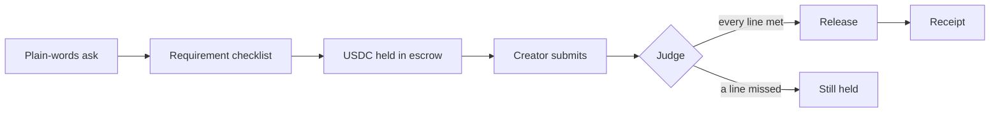
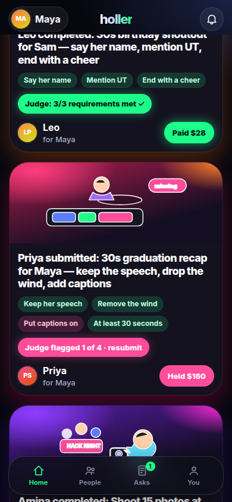
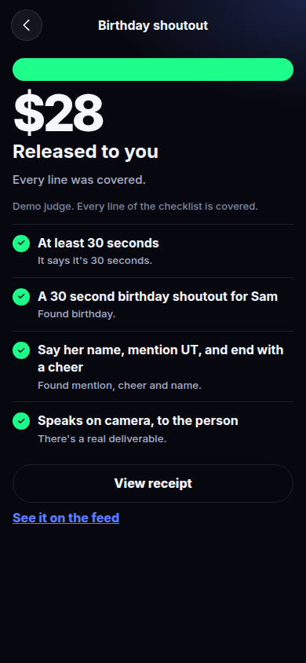

# Holler

Ask someone for a shoutout or a digital job. The money stays locked until an AI judge says the work matches the ask.

UBC 2026 hackathon, Consumer Applications. Social app on the surface. Solana escrow underneath.

## What it does

- A phone feed of finished jobs: who did what, for whom, and whether the judge signed off.
- You describe the ask in plain words. Grok turns it into a requirement checklist. Without an xAI key, a local judge does the same job.
- USDC is held in the Anchor escrow and shown as dollars. A pass releases it. A miss keeps it held so the creator can resubmit.
- Wallets are embedded. No seed phrase, no gas screen. The app pays the network fee.
- Optional: post the release on X when the creator opts in, and take new asks from `@holler` mentions.

## How it works

1. Pick a creator and write the ask.
2. The judge writes the checklist. You can edit the lines.
3. Hold the price. The dollars sit in escrow.
4. The creator submits the video or the files.
5. The judge checks each requirement. Pass releases. Miss stays held.
6. The receipt shows the amount, the escrow account, and an explorer link once the transaction is on devnet.



## Stack

| Piece | What it is |
| --- | --- |
| App | Phone UI in `web/`. Node server in `server/`. |
| Escrow | Anchor program `DN664BTnmAuz1aJNYEJ2HHctRxgRjkRejdyjZ9pjMgvh` (`programs/trustlancer_escrow`). One milestone per ask: fund, submit, approve, dispute, refund. |
| Judge | Grok via the xAI API when `XAI_API_KEY` is set. Otherwise `server/logic.mjs`. |
| Chain | Solana devnet. QuickNode RPC via `SOLANA_RPC_URL`. Streams post escrow events to `/api/hooks/quicknode` (`quicknode/filter.js`). |
| X | Optional. OAuth user tokens post a release. A bearer token reads `@holler` mentions. |

Devnet keys, the fee payer, and a later mainnet swap are in [SETUP.md](SETUP.md). This program is a hackathon build. Do not put real funds in it.

### Live on devnet

The program is deployed at [`DN664BTn…Mgvh`](https://explorer.solana.com/address/DN664BTnmAuz1aJNYEJ2HHctRxgRjkRejdyjZ9pjMgvh?cluster=devnet). One $28 shoutout, end to end:

- Hold: [`create_escrow` + `fund_escrow`](https://explorer.solana.com/tx/5nVMigXDygQE2XaBustrceY9UAAaUphKMJE2k3qgSoSo1Kbb8KW66U1KtNbBVHh2TE5n7VHDTqGuJTGVxYzLGhJf?cluster=devnet)
- Release: [`submit_milestone` + `approve_milestone`](https://explorer.solana.com/tx/v6Y57u5o3npPszB3babbtMeqBCRh617jpJCZWXw9C5bDkKuLfRn7WFosKnATCRKbx7JqiWoE9rvryuVSAUmAwam?cluster=devnet)

Each transaction carries a `holler <action> escrow=… cents=…` memo, which is what the QuickNode filter reads.

### What keeps it honest

- **The judge can't be talked into paying.** The creator's delivery is treated as data, not instructions. Grok is told that a claim about the work ("it's 30 seconds") isn't the work. Text that tries to steer the judge holds the money, and the local rules can still veto a banned topic after Grok passes it (`server/store.mjs`, `guard`).
- **Keys stay off GitHub.** The fee payer, which is also the program's upgrade authority, is a random keypair in `data/` (gitignored). Embedded wallets are derived from a per-machine secret in `data/wallet-secret`. Nothing in the repo rebuilds either.
- **The live feed only trusts the program.** The QuickNode filter keeps successful transactions that call the escrow program, not any transaction with a "holler" memo. The webhooks need `HOLLER_HOOK_SECRET`, and without it they only answer calls from the same machine.

## Demo

[48-second walkthrough](media/holler-demo.mp4): scroll the feed, ask Leo for a shoutout, hold $28, watch the judge check each line, then the receipt and the You page.

| Feed | A pass and a miss | Released | Receipt |
| --- | --- | --- | --- |
|  |  |  |  |

On a fresh start you are Maya. Open Leo, leave the Sam / UT / cheer note, tap **Write the checklist**, then **Hold $28**. **Continue** switches the phone to Leo. **Fill a take that passes** and **Send it**. The checklist goes green. **View receipt** is the share card. **View on explorer** appears after the devnet program is deployed and the transaction has a signature. **Fill a take that misses** leaves the money held.

Switch people from the face at the top left. Eden's Northroom board is the same hold, assigned by a studio.

## Quick start

```sh
npm install
cp .env.example .env
npm start
```

Open http://localhost:5173. Empty `.env` is fine: local judge, no X posts, in-process ledger until the program is on devnet.

```sh
npm run test:app
```

That covers the checklist, a hold through release and refund, an X mention, and a QuickNode event.

## Keys and devnet

[SETUP.md](SETUP.md) is the runbook: xAI, X, QuickNode RPC and Streams, funding the fee payer, `scripts/deploy-devnet.sh`, and what changes for mainnet.
