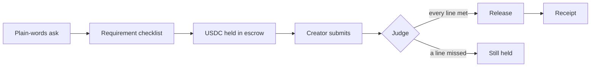
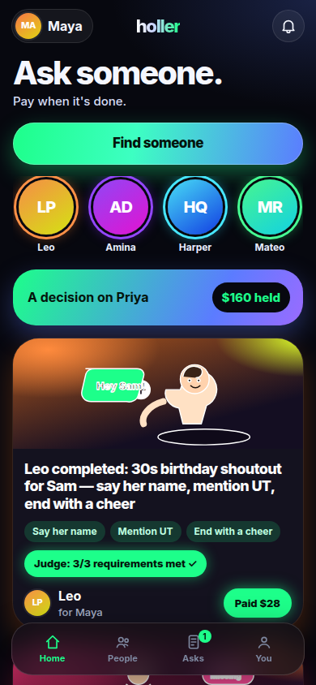
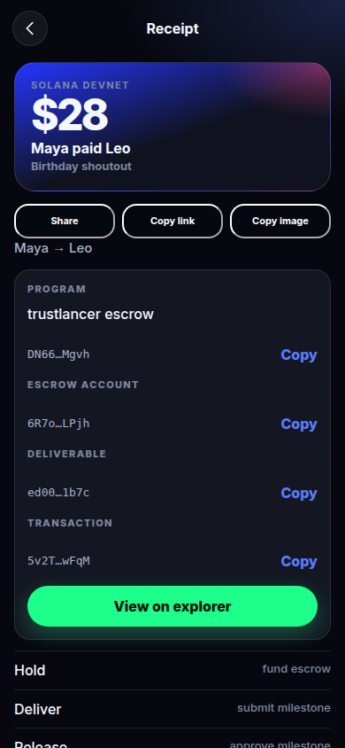

# Holler

Ask someone for a shoutout or a digital job. The money stays locked until an AI judge says the work matches the ask.

UBC 2026 hackathon, Consumer Applications. Social app on the surface. Solana escrow underneath.

## What it does

- A phone feed of finished jobs: who did what, for whom, and whether the judge signed off.
- You describe the ask in plain words. Grok turns it into a requirement checklist. Without an xAI key, a local judge does the same job.
- USDC is held in the Anchor escrow and shown as dollars. A pass releases it. A miss keeps it held so the creator can resubmit.
- Wallets are embedded. No seed phrase, no gas screen. The app pays the network fee.
- Optional: post the release on X when the creator opts in, and take new asks from `@holler` mentions.

## How it works

1. Pick a creator and write the ask.
2. The judge writes the checklist. You can edit the lines.
3. Hold the price. The dollars sit in escrow.
4. The creator submits the video or the files.
5. The judge checks each requirement. Pass releases. Miss stays held.
6. The receipt shows the amount, the escrow account, and an explorer link once the transaction is on devnet.



## Stack

| Piece | What it is |
| --- | --- |
| App | Phone UI in `web/`. Node server in `server/`. |
| Escrow | Anchor program `DN664BTnmAuz1aJNYEJ2HHctRxgRjkRejdyjZ9pjMgvh` (`programs/trustlancer_escrow`). One milestone per ask: fund, submit, approve, dispute, refund. |
| Judge | Grok via the xAI API when `XAI_API_KEY` is set. Otherwise `server/logic.mjs`. |
| Chain | Solana devnet. QuickNode RPC via `SOLANA_RPC_URL`. Streams post escrow events to `/api/hooks/quicknode` (`quicknode/filter.js`). |
| X | Optional. OAuth user tokens post a release. A bearer token reads `@holler` mentions. |

Devnet keys, the fee payer, and a later mainnet swap are in [SETUP.md](SETUP.md). This program is a hackathon build. Do not put real funds in it.

## Live on devnet

| What | Link |
| --- | --- |
| Program | [DN664BTn…Mgvh](https://explorer.solana.com/address/DN664BTnmAuz1aJNYEJ2HHctRxgRjkRejdyjZ9pjMgvh?cluster=devnet) |
| Deploy | [5EMFD5NQ…Ud76](https://explorer.solana.com/tx/5EMFD5NQbimXVp15RgfHbnkFpa1iphAuTm7EXhyiQFPbcRZ4iiDbfBiAcnSVENV3B7vVFbjd4Qypi28aryJdUd76?cluster=devnet) |
| Hold $28 (`create_escrow` + `fund_escrow`) | [4GgXFTgU…9MhN](https://explorer.solana.com/tx/4GgXFTgUymLrAT3w3pL1oUksXUXHkP5fwbmDiHSmA2qUN48CE5Hp9phEhaAJJzargDavqN7S9xoHytU9F5A49MhN?cluster=devnet) |
| Release after the judge passes (`submit_milestone` + `approve_milestone`) | [xayQLNcg…MmT7](https://explorer.solana.com/tx/xayQLNcgCYuDUAqjWoTtBSmstoEgWhzG4MzdrU5dzJP8SJz3s1vAQo8x7qLSCdQBKKxMsvzb1ogJ8ZyAtEQMmT7?cluster=devnet) |

Every transaction is signed by the buyer's or creator's embedded wallet and paid for by the app's fee payer, `9DHA77NkTk5aqqDF3BpJKgZn9qXvpu19A4bDXCkFtTfi`. Each one carries a `holler …` memo so a QuickNode Stream can pick it up.

## Demo

[53-second walkthrough](media/holler-demo.mp4), recorded on devnet with the live Grok judge: scroll the feed, ask Leo for a shoutout, Grok writes the checklist, hold $28, Grok flags a take that misses and the money stays held, Leo resubmits, Grok passes every line and the hold releases, then the receipt, the transaction on Solana Explorer, and the You page. Waits for Grok and the network are cut.

| Feed | A pass and a miss | Released | Receipt |
| --- | --- | --- | --- |
|  |  |  |  |

On a fresh start you are Maya. Open Leo, leave the Sam / UT / cheer note, tap **Write the checklist**, then **Hold $28**. **Continue** switches the phone to Leo. **Fill a take that passes** and **Send it**. The checklist goes green. **View receipt** is the share card. **View on explorer** opens the transaction on Solana Explorer. **Fill a take that misses** leaves the money held, and **Try another take** sends it again. The seeded feed jobs are put on devnet the first time the app starts, so their receipts have explorer links too.

Switch people from the face at the top left. Eden's Northroom board is the same hold, assigned by a studio.

## Quick start

```sh
npm install
cp .env.example .env
npm start
```

Open http://localhost:5173. Empty `.env` is fine: local judge, no X posts, in-process ledger until the program is on devnet.

```sh
npm run test:app
```

That covers the checklist, a hold through release and refund, an X mention, and a QuickNode event.

## Keys and devnet

[SETUP.md](SETUP.md) is the runbook: xAI, X, QuickNode RPC and Streams, funding the fee payer, `scripts/deploy-devnet.sh`, and what changes for mainnet.
